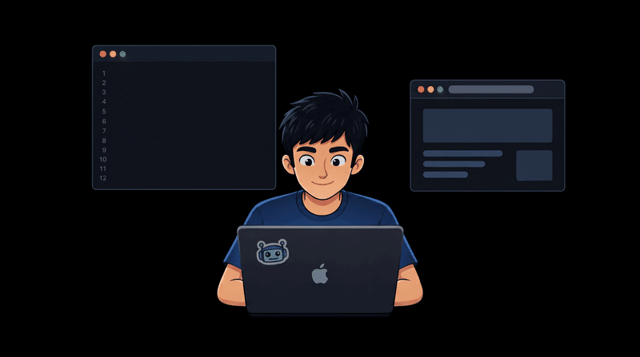

# Hey there, I'm **Ishan Tarkas**

### `> Learning AI by Building AI.`

---

### 🧑‍💻 About Me

- **B.Tech** in Artificial Intelligence & Data Science  
- **K.J. Somaiya Institute of Technology**
- **CGPA: 9.23** — Consistently top of class
- Currently building **end-to-end deployable AI projects**
- Deep-diving into **LLMs, RAG pipelines & production NLP**
- My best work → [**Definition Drift**](https://definitiondrift.ishan-tarkas.in/)
- Reach me at **tarkasishan7536@gmail.com**

 

---

### 🌐 Connect With Me

  
  
  
  
  

---

### 🛠️ Tech Stack

#### AI / ML / DL

#### Infrastructure & DevOps

#### Databases & Backend

#### Frontend & Other

---

### 📊 GitHub Stats

---

### 🚀 Featured Projects

| Project | Description | Stack |
|--------|-------------|-------|
| [**Definition Drift**](https://definitiondrift.ishan-tarkas.in/) | Flagship AI-powered NLP web app | Python · LLMs · Vue.js |
| **Research Copilot** | Full-stack RAG pipeline for AI research assistance | RAG · LangChain · FastAPI |

> 🔗 *More projects pinned below ↓*

---

### 📈 Activity Graph

---

### 💬 *"The best way to learn AI is to ship AI."*

